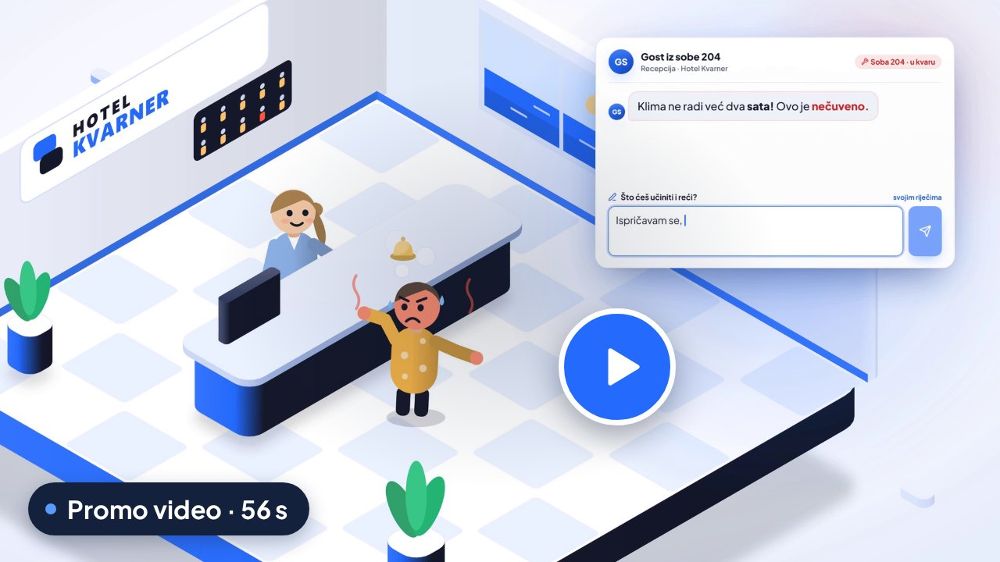
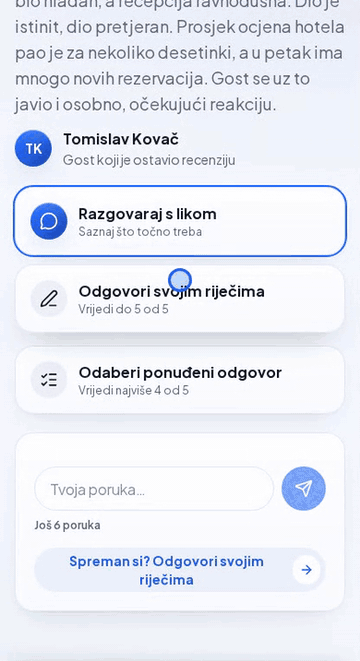
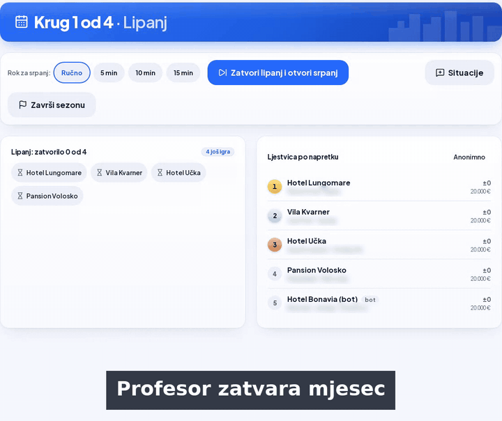
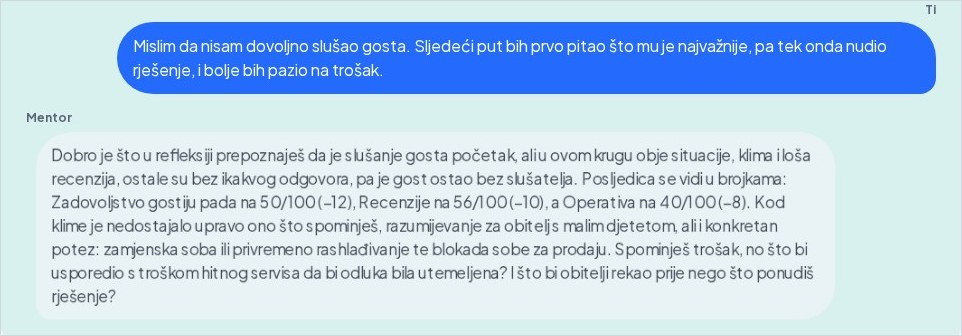
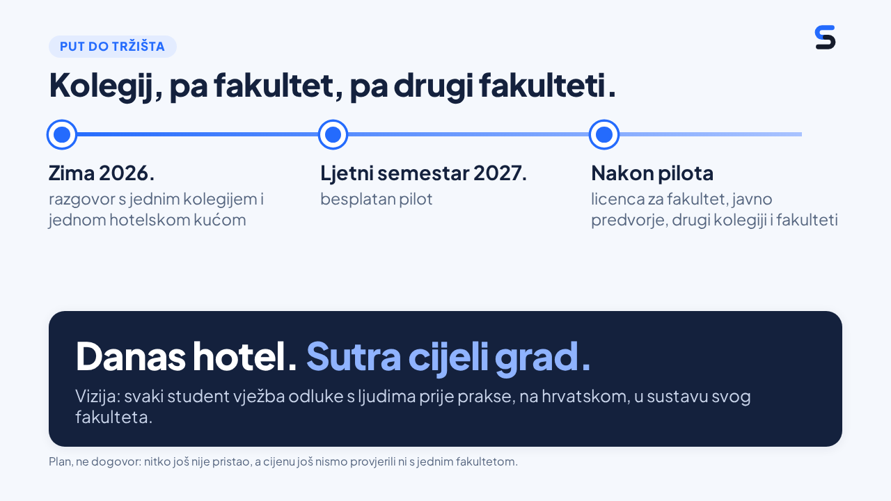
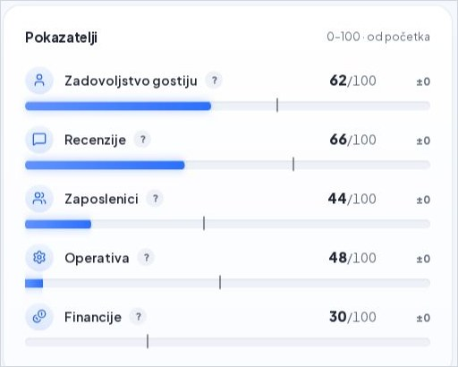
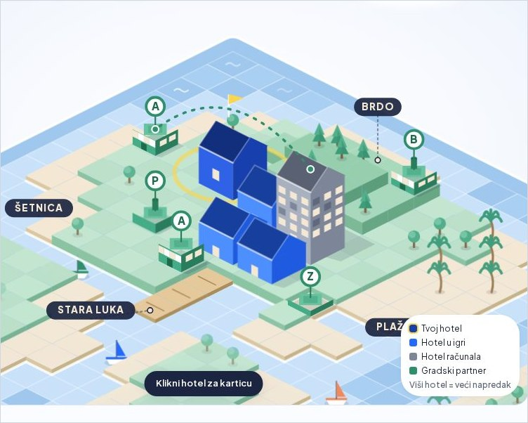
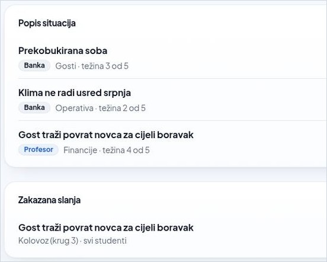
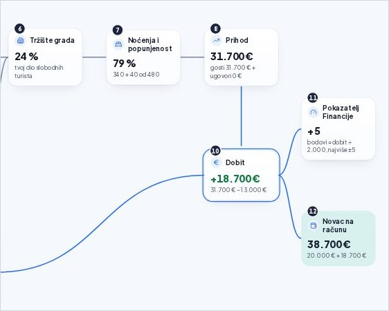
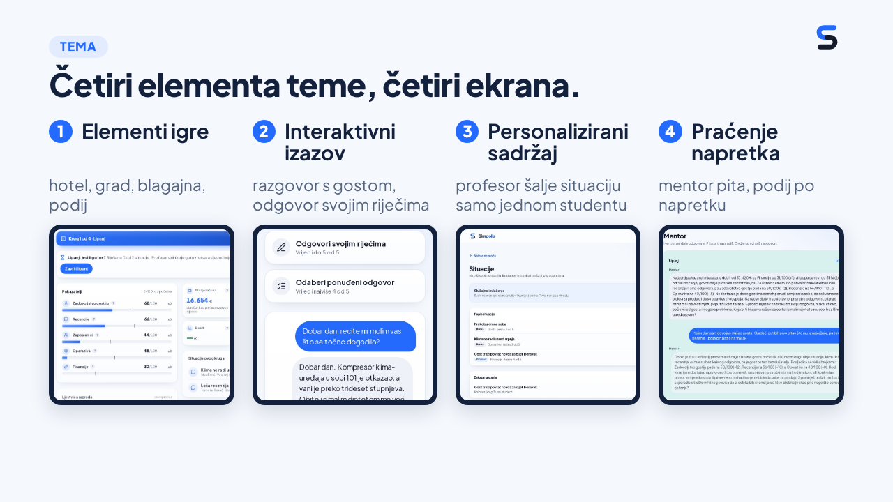

<p align="center"><a href="README.md">Hrvatski</a> · <b>English</b></p>

<p align="center">
  <a href="https://riihack.vercel.app/profesor"><picture>
    <source media="(prefers-color-scheme: dark)" srcset="docs/media/banner-en-dark.jpg">
    
  </picture></a>
</p>

<p align="center">
  <a href="https://github.com/leonkreso784-bit/riihack/releases/tag/ri-hack-4.0"></a>
  <a href="https://riihack.vercel.app/profesor"></a>
  <a href="https://github.com/leonkreso784-bit/riihack/actions/workflows/ci.yml"></a>
  <a href="docs/ROADMAP.md"></a>
</p>

<p align="center">
  <b>A game for hospitality students: you run a hotel, talk to guests played by AI and learn from the consequences of your decisions.</b><br>
  <a href="https://riihack.vercel.app/profesor"><b>Try it live</b></a> · <a href="#try-it-yourself">How to try it</a> · <a href="#simpolis-in-56-seconds">Promo video</a> · <a href="https://prezentacijariihack.vercel.app/">Presentation</a> · <a href="docs/STATUS.md">Project status</a>
</p>

## In short

**The problem.** A hospitality student, let's call her Ana, meets her first angry guest only during her internship. At FMTU the [professional internship](https://fthm.uniri.hr/zivotfmtu/centar-za-karijere-i-strucnu-praksu/strucna-praksa/) (420 hours, page in Croatian) only takes place in the 8th semester, in the fourth year. Until then she learns from theory and can also reach for ready-made AI answers. That has a cost: in a [2025 PNAS study](https://doi.org/10.1073/pnas.2422633122), high-school students who practised with GPT-4 without guardrails scored 17% lower on an exam without AI than those who never had it (high-school mathematics; whether the same holds for hospitality has not been tested).

- **What it is:** a web game for hospitality and tourism students. A professor opens a game, the class joins with a code, and each student runs their own hotel in a shared town on the Kvarner coast, month by month.
- **What the AI does:** it plays guests and staff, grades answers against a rubric and, as a mentor, asks first and only then explains. **Every number is computed by the game rules, not by the AI.**
- **It works:** the main loop runs live on real code, and 1,085 tests pass. Built in 24 hours at the Ri-Hack 4.0 hackathon, 3rd place out of 8 teams.
- **Not ready for a pilot yet:** the list of what is missing is in the [Status](#status-does-it-work) section.
- **Next (a plan):** a free pilot at FMTU in Opatija in 2027, then licences for faculties. Nothing is agreed yet, see the [Plan](#plan).

## Try it yourself

All you need is a browser. You open the game yourself, as the professor, so you do not need a game code in advance. Use made-up data. When you are done, delete the game with **Obriši igru** at the bottom of the game board. The app itself is in Croatian.

1. Open [riihack.vercel.app/profesor](https://riihack.vercel.app/profesor) and choose **Napravi račun** (create an account).
2. Choose **Nova igra** (new game), enter a name and choose **Napravi igru** (create game; the number of students can stay at 24). You get a game code and a QR code.
3. On your phone (or in another window) open [riihack.vercel.app/ulaz](https://riihack.vercel.app/ulaz) and enter the code, your name and a hotel name. You are now a student.
4. On the professor screen choose **Popuni do 5 hotela** (fill up to 5 hotels; bots make up the market) and **Pokreni igru** (start game).
5. On your phone open a situation, talk to the guest and answer in your own words. The month is closed on the professor board.

## Simpolis in 56 seconds

<p align="center">
  <a href="https://prezentacijariihack.vercel.app/video/simpolis-promo-1080p.mp4"></a><br>
  <sub>Click to play the video in your browser (28 MB, with sound, on-screen text in Croatian). To download it: <a href="https://github.com/leonkreso784-bit/riihack/releases/tag/promo-video">release <code>promo-video</code></a>.</sub>
</p>

## How to play

The professor opens a game, the class joins with a code or QR code, and each student gets one of six hotels. The professor can add bots, so even a small class has a market. Then every month goes like this. The recordings and screenshots below show the Croatian interface.

1. **A guest has a problem.** Two situations arrive, for example the air conditioning breaks in the middle of the season. The AI plays the guest, and the student talks to them to find out what they actually need.
2. **Answer and verdict.** The student's own words are worth up to 5 out of 5, an offered answer at most 3. An AI judge marks which rubric criteria the answer met and explains why, and the rules compute the points.

<p align="center">
  <br>
  <sub>Talking to a guest, an answer in the student's own words and the rubric verdict. The wait for the AI is shortened. Recorded at the hackathon on 25 Oct 2026.</sub>
</p>

3. **Plan and month close.** The student sets the price, marketing and investment in departments. The professor closes the month, and the rules compute occupancy, cash and reviews for every hotel, because they all share the same tourists. The podium ranks progress, not money.

<p align="center">
  
  <br><sub>The professor closes the month and the class sees the podium. Player names in the recording are blurred.</sub>
</p>

4. **The mentor asks first, then explains.** The mentor asks about the month's weakest decision, the student reflects, and the mentor replies. After four months (June to September) comes the season podium.

<p align="center">
  <a href="docs/media/mentor.jpg"></a><br>
  <sub>The student reflects and the mentor follows up with questions. Click to open the full page.</sub>
</p>

## Plan

**All of this is a plan (a goal), not an agreement.** No faculty, hotel or SRCE has signed on, no talk with FMTU has taken place yet, and we have not tested the price with any faculty. The only firm date is the incubator application deadline, 16 Nov 2026. Details: [docs/ROADMAP.md](docs/ROADMAP.md) (Croatian).

<p align="center"></p>

- **Incubator:** the application to the Startup Incubator Rijeka (RiHub), 18th generation, is in preparation. The deadline is 16 Nov 2026, and a committee decides on entry.
- **Pilot:** we plan a free pilot in one course at FMTU (Faculty of Tourism and Hospitality Management, Opatija), in the 2027 summer semester.
- **Faculties:** after the pilot we plan a licence for the whole faculty, targeting from 10 EUR per student per year. By our own estimate our AI cost is about $0.07 per student per season. We also plan entry from Merlin (LTI) and AAI@EduHr login through SRCE (University Computing Centre); we are seeking that cooperation and it is not agreed.
- **Hotels and companies:** we plan real situations from their business and a path to internships, later training for staff. We have not asked any company yet.
- **Much later:** a multiplayer town where students sign contracts with each other, no date.

## Status: does it work?

The main loop works end to end on real code. The figures are from `main` as of 26 Oct 2026. The version the jury judged is kept at the tag [`ri-hack-4.0`](https://github.com/leonkreso784-bit/riihack/releases/tag/ri-hack-4.0).

| What | Figures |
| --- | --- |
| **Checks** | 1,085 tests in 80 files pass; typecheck, lint, build and CI are green |
| **Content** | 6 hotels, 8 situations, 6 city businesses, 8 contract templates |
| **Scope** | 26 pages, 38 API route files, 20 database tables |
| **Development** | 700 commits and 246 merged pull requests (236 during the hackathon) |

<p align="center">
  <a href="docs/img/hotel.jpg"></a>&nbsp;&nbsp;
  <a href="docs/media/grad.jpg"></a><br>
  <sub>Left: hotel indicators (student). Right: the shared town (student). Click to open the full screen. Croatian interface.</sub>
</p>

<p align="center">
  <a href="docs/img/prof.jpg"></a>&nbsp;&nbsp;
  <a href="docs/media/tokovi.jpg"></a><br>
  <sub>Left: situations for the class (professor). Right: where every number came from (student). Click to open the full screen. Croatian interface.</sub>
</p>

**Not ready for a pilot yet.** Still missing: manual approval of professor accounts and password reset, a PIN for student re-entry, a season length that fits a semester, and migrations with a separate pilot database ([docs/STATUS.md](docs/STATUS.md#što-fali-za-pilot), Croatian).

**Not done yet:** a season is fixed at four months, there are only 8 situations and all are about hotels, and everything is in Croatian. The flow that writes to the database is checked with a manual smoke script that CI does not run. The mentor's monthly review is becoming a question instead of advice ([#302](https://github.com/leonkreso784-bit/riihack/issues/302)). Since 26 Oct the economy is calibrated to Kvarner hotels (season margin 14 to 20 %), and a professor can export grades as CSV and delete a game. What the pilot still needs: the [Pilot FMTU](https://github.com/leonkreso784-bit/riihack/milestone/6) milestone. Details and known bugs: [docs/STATUS.md](docs/STATUS.md) (Croatian).

## Under the hood

<details>
<summary><b>How it works: rules, AI and professor</b></summary>

| Who | What it does |
| --- | --- |
| **Game rules** (code) | Compute money, occupancy, the market and points. Pure functions with no database or network access, covered by tests. |
| **AI** (Claude) | Plays characters (Haiku 5.5), judges and runs the mentor (Sonnet 5.5). It computes nothing: it returns criterion ids and text, and any figures in that text come from the rules' calculations. |
| **Professor** | Can change the grade of any answer and reviews every AI-proposed situation before it is sent. |

Every AI call has a time limit and a fallback answer, so the game keeps working when the AI does not respond.

</details>

<details>
<summary><b>Ri-Hack 4.0: the theme and its four elements</b> (game elements, interactive challenge, personalised content, progress tracking)</summary>

The hackathon theme was "Encouraging people to learn in the age of artificial intelligence", and it suggests four elements. Each one is a real feature of the game:

| Theme element | In Simpolis |
| --- | --- |
| **Game elements** | Your own hotel, money and five indicators, a shared town and market, a podium, bots as rivals. |
| **Interactive challenge** | A conversation with a character played by AI, an answer in your own words, a verdict against the rubric. |
| **Personalised content** | The professor sends situations to the whole class or to a single student. The AI proposes a situation aimed at the hotel's weakest indicator, and the professor reviews it before it is sent. |
| **Progress tracking** | A ranking by progress, a mentor who asks about the weakest decision, and a professor view of every answer and verdict. |

<p align="center"></p>

The judged version: [release `ri-hack-4.0`](https://github.com/leonkreso784-bit/riihack/releases/tag/ri-hack-4.0). Hackathon archive: [docs/hackathon/](docs/hackathon/README.md) (Croatian).

</details>

## For developers

You need Node 24, npm and your own empty Neon database.

```bash
git clone https://github.com/leonkreso784-bit/riihack.git && cd riihack
npm ci
cp .env.example .env.local   # DATABASE_URL, ANTHROPIC_API_KEY, BETTER_AUTH_SECRET, BETTER_AUTH_URL
npm run db:push              # only on your own empty database, never on a shared one (ADR-026)
npm run dev                  # http://localhost:3000
```

- **Interface only, no database or keys:** set `NEXT_PUBLIC_USE_MOCK=1` in `.env.local`. Only the value `0` switches on the real API and database.
- **Stack:** Next.js 16, React 19, TypeScript, Tailwind CSS 4 · Neon Postgres and Drizzle · Claude through the Vercel AI SDK · Better Auth · Vercel and GitHub Actions.
- **More:** [docs/RAZVOJ.md](docs/RAZVOJ.md) (setup, tests, PR rules), [docs/ARHITEKTURA.md](docs/ARHITEKTURA.md) (engine, AI layer, database, API), [docs/README.md](docs/README.md) (all documentation). The documentation is in Croatian.

## Team

Team **Pojedinci**:

- **Leon Kreso:** integration, database, processes.
- **Rino Tomić:** frontend and interface design.
- **Simon Seifert:** game, AI, pitch.

Questions, pilot and collaboration: [GitHub Issues](https://github.com/leonkreso784-bit/riihack/issues).

## License

All rights reserved. The copyright is held jointly by Leon Kreso, Rino Tomić and Simon Seifert. The code is publicly visible for review and portfolio purposes only: without the written permission of all copyright holders you may not copy, modify, distribute or use it, in whole or in part. Third-party dependencies keep their own licences. See [LICENSE](LICENSE).
