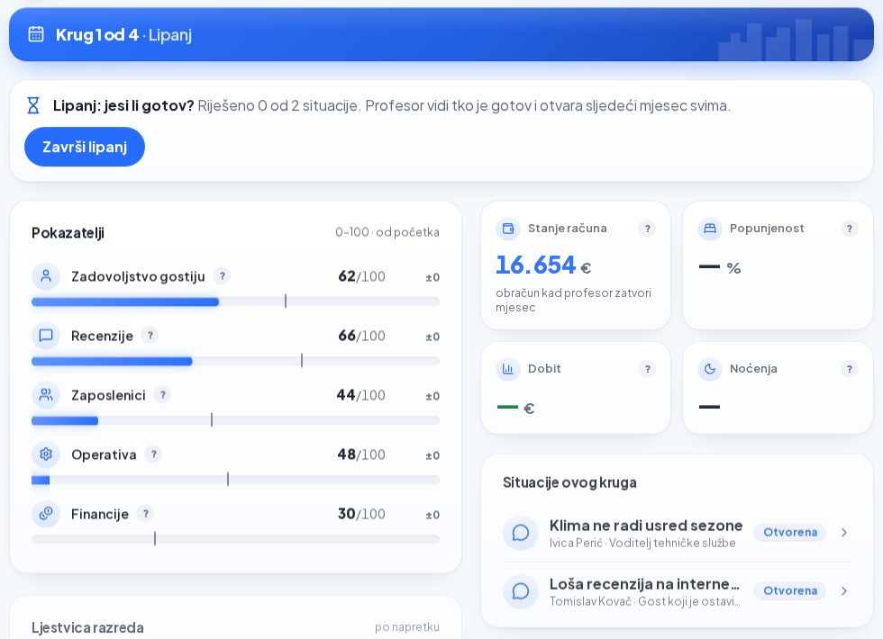
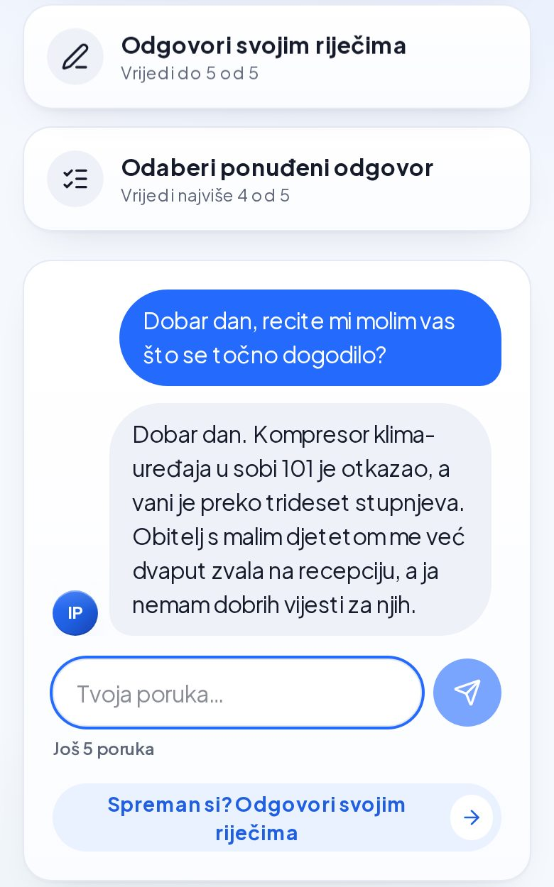
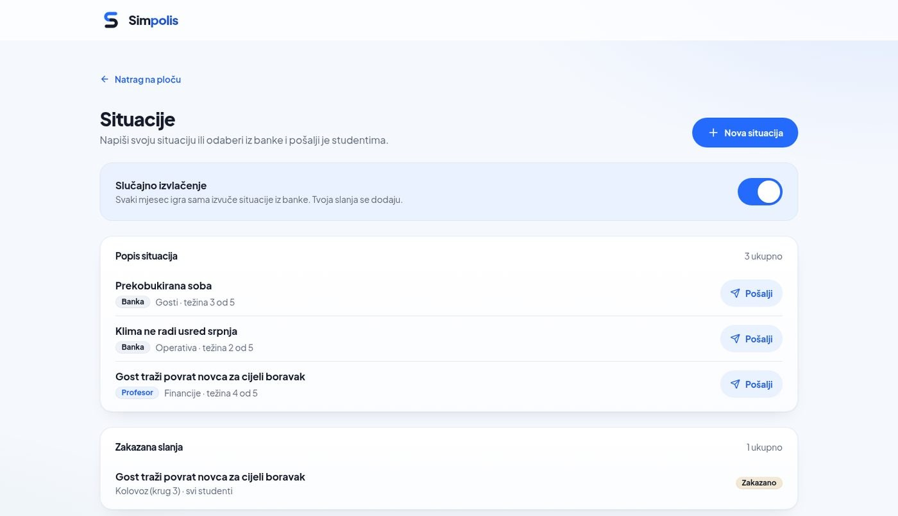

# Simpolis

> Igra za učenje vođenja hotela: student vodi hotel, razgovara s gostima koje glumi AI, a svaki broj izračunavaju pravila igre, ne AI.

English: [README.en.md](README.en.md)

## TL;DR

- **Simpolis** je web igra za studente ugostiteljstva i turizma. Profesor otvori igru, razred uđe kodom, svaki student vodi svoj hotel u zajedničkom gradu, mjesec po mjesec.
- AI glumi goste i osoblje, ocjenjuje slobodne odgovore po rubrici i kao mentor postavlja pitanja za razmišljanje. **Sve brojke (novac, popunjenost, ocjene) računaju pravila igre.**
- Izrađen u 24 sata na hackathonu Ri-Hack 4.0 (Rijeka, 24. i 25. listopada 2026.): **3. mjesto od 8 timova**. Radi uživo na <https://riihack.vercel.app/>. Isprobaj: otvori `/profesor`, napravi račun i igru, pa uđi kao student na `/ulaz`.
- Nastavljamo kao startup: plan je besplatni pilot na FMTU-u u Opatiji, zatim licence za fakultete.
- Sva prava pridržana. Kod je javno vidljiv samo radi pregleda i portfelja (vidi [Licenca](#licenca)).

<p align="center">
  
</p>
<p align="center">
  
  
</p>
<p align="center"><sub>Student: ploča hotela i razgovor s likom. Profesor: situacije za razred.</sub></p>

## Poveznice

| Što | Gdje |
| --- | --- |
| Aplikacija uživo | <https://riihack.vercel.app/> |
| Web prezentacija | <https://prezentacijariihack.vercel.app/> |
| Verzija koju je ocjenjivao žiri | [release `ri-hack-4.0`](https://github.com/leonkreso784-bit/riihack/releases/tag/ri-hack-4.0) (commit `b6ffb61`) |
| Promo video | [release `promo-video`](https://github.com/leonkreso784-bit/riihack/releases/tag/promo-video) |

**Kako isprobati (detaljnije):** na `/profesor` napravite profesorski račun, otvorite igru, dodajte botove ili uđite kodom igre na `/ulaz` kao student (npr. s mobitela). Koristite izmišljene nadimke, to je demo.

## Što je Simpolis

Studenti ugostiteljstva prve ljutite goste upoznaju tek na stručnoj praksi, kad pogreška košta pravog gosta. AI s gotovim odgovorima tu ne pomaže: učenici koji su vježbali uz GPT-4 bez ograda imali su na ispitu bez AI-a 17 % lošiji rezultat (Bastani i sur., PNAS 2025, srednjoškolska matematika).

Simpolis zato daje sigurno mjesto za vježbu odluka s ljudima i novcem. Petlja igre:

1. **Profesor napravi igru.** Razred ulazi kodom ili QR kodom, svaki student dobiva jedan od šest hotela na Kvarneru.
2. **Situacije.** Svaki mjesec stižu dvije situacije: gost ili član osoblja s problemom (npr. klima ne radi usred sezone). Student s likom razgovara, do šest poruka.
3. **Odgovor i rubrika.** Ponuđeni odgovor vrijedi najviše 3 od 5, vlastite riječi do 5 od 5. AI sudac po rubrici od pet kriterija označava što je odgovor zadovoljio.
4. **Plan.** Student postavlja cijenu, marketing i ulaganja u odjele hotela.
5. **Zatvaranje mjeseca.** Profesor zatvara mjesec, pravila izračunavaju popunjenost, novac i recenzije (svi hoteli dijele iste turiste), a razred vidi podij mjeseca.
6. **Mentor.** Mentor postavlja pitanje o najslabijoj odluci mjeseca, student razmišlja, mentor odgovara.

Sezona traje četiri mjeseca (lipanj do rujan) i završava podijem sezone.

## Kako radi

| Tko | Što radi |
| --- | --- |
| **Pravila igre** (kod) | Računaju novac, popunjenost, tržište i kvalitetu odgovora. Čiste funkcije bez baze i mreže, pokrivene testovima. |
| **AI** (Claude) | Glumi goste i osoblje (Haiku 5.5), sudi po rubrici i vodi mentora (Sonnet 5.5). Ne računa ništa: vraća oznake kriterija ili tekst, a brojke u tekstu uzima iz izračuna pravila igre. |
| **Profesor** | Ima zadnju riječ: može promijeniti ocjenu odgovora, a svaki AI prijedlog situacije pregleda i spremi prije slanja. |

Svaki AI poziv ima rok i rezervni odgovor, pa igra radi i kad AI ne odgovori. Mentor prvo pita, tek onda objašnjava.

## Stanje

Verzija `ri-hack-4.0` radi od početka do kraja: ulazak kodom, ploča hotela, situacije s razgovorom i ocjenom po rubrici, plan i financije, grad s ugovorima s gradskim tvrtkama, zatvaranje mjeseca s podijem, mentor, profesorov pregled i botovi.

- **Provjere:** 1030 testova u 75 datoteka prolaze, typecheck i lint bez grešaka, build prolazi, CI je zelen.
- **Sadržaj:** 6 hotela, 8 situacija, 6 gradskih tvrtki, 8 predložaka ugovora. 26 stranica, 37 datoteka API ruta, 19 tablica u bazi.
- **Razvoj:** 671 commit i 236 spojenih pull requestova na `main`, sve tijekom hackathona.
- **Još nije gotovo:** sezona je fiksno četiri mjeseca, situacija je samo 8 i sve su hotelske, nema engleskog jezika ni izvoza ocjena. Prijava preko fakulteta (AAI@EduHr, Merlin) je cilj. PIN za ulazak studenta je planiran ([ADR-053](docs/records/DECISIONS.md#adr-053)).

Detalji i poznati bugovi: [docs/STATUS.md](docs/STATUS.md).

## Plan

- **Pilot:** besplatni pilot na FMTU-u u Opatiji (Fakultet za menadžment u turizmu i ugostiteljstvu). Popis što još treba za pilot vodi se u [GitHub Issues](https://github.com/leonkreso784-bit/riihack/issues), u milestoneu [Pilot FMTU](https://github.com/leonkreso784-bit/riihack/milestone/6).
- **Fakulteti:** licence za fakultete, od 10 EUR po studentu godišnje. Našu procjenu troška AI-ja držimo na oko 7 centi po studentu po sezoni. Cijena je plan, još nije potvrđena.
- **Poduzeća:** obuke za hotele i tvrtke.
- **Kasnije:** višekorisnička web igra i integracija sa SRCE-om (Merlin preko LTI-ja, prijava AAI@EduHr). Integracija je cilj, nije dogovorena.
- **Inkubator:** prijavljujemo se u Startup inkubator Rijeka (RiHub), 18. generacija.

Detalji: [docs/ROADMAP.md](docs/ROADMAP.md).

## Pokretanje lokalno

Treba Node 24, npm i vlastita prazna Neon baza.

```bash
git clone https://github.com/leonkreso784-bit/riihack.git && cd riihack
npm ci
cp .env.example .env.local   # upiši DATABASE_URL, ANTHROPIC_API_KEY, BETTER_AUTH_SECRET, BETTER_AUTH_URL
npm run db:push              # samo na svojoj praznoj bazi, nikad na zajedničkoj (ADR-026)
npm run dev                  # http://localhost:3000
```

- **Samo sučelje, bez baze i ključeva:** u `.env.local` postavi `NEXT_PUBLIC_USE_MOCK=1`.
- **Pazi na `NEXT_PUBLIC_USE_MOCK`:** samo vrijednost `0` uključuje pravi API i bazu. Svaka druga vrijednost, uključujući praznu, znači lažne podatke iz `src/lib/mock.ts`.
- Provjere prije svakog PR-a, demo podaci, smoke test i sve ostalo: [docs/RAZVOJ.md](docs/RAZVOJ.md).

## Tehnologija

| Sloj | Što |
| --- | --- |
| Sučelje | Next.js 16 (App Router), React 19, TypeScript, Tailwind CSS 4, shadcn/ui |
| Pravila igre | Čiste TypeScript funkcije u `src/lib/engine/`, bez baze i mreže, testirane Vitestom |
| AI | Vercel AI SDK, Claude Haiku 5.5 (likovi, odgovori agencija), Claude Sonnet 5.5 (sudac, mentor, prijedlog situacije) |
| Baza | Neon Postgres, Drizzle ORM |
| Prijava | Better Auth za profesore, kod igre i nadimak za studente |
| Hosting i CI | Vercel, GitHub Actions (typecheck, lint, testovi, build) |

Arhitektura u detalje: [docs/ARHITEKTURA.md](docs/ARHITEKTURA.md). Sva dokumentacija: [docs/README.md](docs/README.md).

## Ri-Hack 4.0

Simpolis je nastao u 24 sata na hackathonu Ri-Hack 4.0 (Rijeka, 24. i 25. listopada 2026.) na temu „Poticanje ljudi na učenje u doba umjetne inteligencije". Tim Pojedinci osvojio je **3. mjesto od 8 timova**. Vremenska crta, plan, predaja i prezentacija: [docs/hackathon/README.md](docs/hackathon/README.md).

## Tim

Tim **Pojedinci**:

- **Leon Kreso:** integracija, baza, procesi.
- **Rino Tomić:** frontend i dizajn sučelja.
- **Simon Seifert:** igra, AI, pitch.

Pitanja, pilot i suradnja: [GitHub Issues](https://github.com/leonkreso784-bit/riihack/issues).

## Licenca

Sva prava pridržana. Autorska prava drže zajedno Leon Kreso, Rino Tomić i Simon Seifert. Kod je javno vidljiv samo radi pregleda i portfelja: bez pisanog dopuštenja svih nositelja nije dopušteno kopirati, mijenjati, distribuirati ni koristiti ga, u cijelosti ili djelomično. Ovisnosti trećih strana zadržavaju vlastite licence. Vidi [LICENSE](LICENSE).
