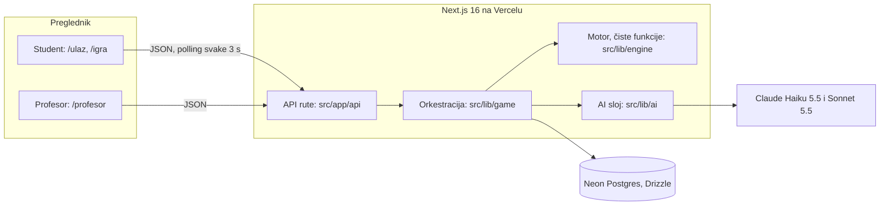
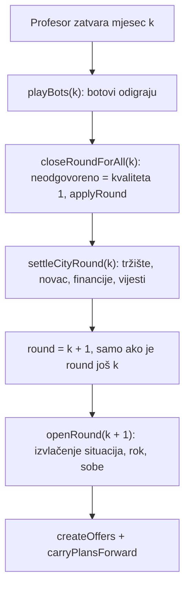
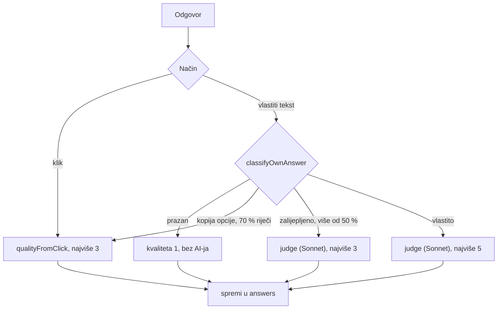

# Simpolis: arhitektura

> **TL;DR**
> - Next.js 16 aplikacija (React 19, TypeScript, Tailwind) na Vercelu: sučelje i API u jednom projektu, baza je Neon Postgres preko Drizzlea.
> - Sve brojke računa **čisti motor** (`src/lib/engine/`) i konstante iz `src/lib/rules.ts`; AI glumi likove, sudi po rubrici i piše mentora, ali nikad ne računa bodove ni novac.
> - Sedam AI funkcija (Claude Haiku 5.5 i Sonnet 5.5 preko Vercel AI SDK-a), svaka s rokom i fiksnom rezervom: igra radi i bez AI ključa.
> - Veličina koda i sadržaja (stranice, API rute, tablice, hoteli, situacije, gradske tvrtke, predlošci ugovora) i rezultati provjera (testovi, tipovi, lint, build, CI) su na jednom mjestu: [STATUS.md](STATUS.md).

**Stanje: 26. 10. 2026. (commit `b6ffb61`, oznaka `ri-hack-4.0`).** Dokument opisuje kod kakav jest. Što još nije napravljeno
je u [STATUS.md](STATUS.md) i [ROADMAP.md](ROADMAP.md), odluke i razlozi u [records/DECISIONS.md](records/DECISIONS.md) (ADR-ovi),
a prvotna ideja u [hackathon/IDEJA.md](hackathon/IDEJA.md).

## 1 · Pregled

Simpolis je simulacija grada za učenje hotelijerstva. Profesor napravi igru, studenti uđu kodom i svaki vodi jedan hotel.
Sezona ima 4 mjeseca (lipanj do rujan). U svakom mjesecu student rješava 2 situacije (klik ili vlastiti odgovor, uz razgovor
s likom koji glumi AI), planira cijenu, marketing i ulaganja u odjele te odlučuje o ugovorima s gradskim tvrtkama. Na kraju
mjeseca motor obračuna cijelo gradsko tržište odjednom, a mentor postavi pitanje i napiše osvrt. Ocjena je **napredak**
pokazatelja u odnosu na početak, a novac se prikazuje uz nju.



## 2 · Načela

1. **AI ne odlučuje o brojkama.** Presuda AI-ja svodi se na popis ispunjenih kriterija rubrike; kvalitetu (1 do 5), pokazatelje,
   novac i tržište piše samo kod motora. Detalji su u §7.
2. **Vlastite riječi vrijede više od klika.** Klik daje najviše 3, vlastiti odgovor do 5. Odgovor koji je prepisana ponuđena
   opcija ili je većinom zalijepljen ne dobiva više od 3 (ADR-059).
3. **Ulogu dobiješ, ne biraš.** Svaki hotel kreće s istim zbrojem pokazatelja (250), drukčije raspoređenim.
4. **Ocjena je napredak**, ne apsolutni rezultat (`progress` u `src/lib/engine/round.ts`).
5. **AI ključ i baza samo na poslužitelju.** Preglednik zove samo naše API rute.
6. **Igra nikad ne stane zbog AI-ja.** Svaki AI poziv ima rok i deterministički tekst za slučaj greške.
7. **Profesor ima zadnju riječ.** Može promijeniti ocjenu odgovora, a AI prijedlog situacije ne stiže studentima dok ga ne spremi.

## 3 · Stack

| Dio | Izbor |
| --- | --- |
| Aplikacija | Next.js 16.4 (App Router, Turbopack), React 19.3, TypeScript (strict), Tailwind 4, shadcn/base-ui, lucide-react |
| API | Route handleri pod `src/app/api/`, tanki omotač `route()` iz `src/lib/http.ts` |
| Baza | Neon Postgres, Drizzle ORM, driver `neon-http` (bez `db.transaction()`; atomarnost kroz `db.batch` i uvjetne `UPDATE ... RETURNING`) |
| Prijava profesora | Better Auth (e-mail i lozinka), tablice u `src/db/auth-schema.ts`; studenti nemaju račune |
| Osvježavanje | polling svake 3 s (`usePoll` u `src/lib/client.ts`) |
| AI | `ai` v7 i `@ai-sdk/anthropic`; lik i e-mail agencije `claude-haiku-5-5`, presuda i mentor `claude-sonnet-5-5` |
| Testovi | Vitest 5, okolina `node`; CI na GitHub Actions |
| Deploy | Vercel (Git integracija, `main`) |

## 4 · Struktura repoa

```
src/
  app/            stranice (26) i API rute (src/app/api, 37 datoteka)
  components/     sučelje: ui/ (shadcn), city/, prof/, tokovi/, wow/ i zajedničke komponente
  content/        hotels.json, situations.json, contracts.json, city.json + index.ts (tipizirani getteri)
  db/             schema.ts, auth-schema.ts, index.ts (lijena veza), queries.ts
  lib/
    types.ts      ugovor API-ja: svi tipovi zahtjeva, odgovora i sadržaja
    rules.ts      sve konstante igre (krugovi, ekonomija, ograničenja)
    ranking.ts    pravilo ljestvice: hotel u blokadi ne stoji iznad solventnog (ADR-059)
    engine/       motor: čiste funkcije, bez baze, mreže i AI-ja (14 modula)
    game/         poslužiteljska orkestracija nad bazom (19 modula) i `season-sim.ts` (simulacija sezone bez baze)
    ai/           svi pozivi modela, promptovi i rezerve (promptovi su TypeScript konstante u prompts.ts)
    tokovi/       modeli prikaza za stranice „Tokovi" (čiste funkcije)
    session.ts, http.ts, auth.ts, client.ts, mock.ts   kolačići i zaštite, omotač ruta, Better Auth, API klijent, lažni podaci
scripts/          seed-demo.ts, smoke.ts, ai-smoke.ts, sim-sezona.ts, cleanup-test-data.ts, lock-merge.py
docs/             dokumentacija (ulaz: docs/README.md)
.github/workflows/ci.yml
```

Mape `drizzle/` i `prompts/` ne postoje: shema se ne generira u migracije, a promptovi su u `src/lib/ai/prompts.ts`.

## 5 · Tok jednog mjeseca

Mjesec zatvara profesor (`POST /api/prof/[worldId]/round`), istek roka ili završetak sezone. Student može zatvoriti i samo svoj mjesec.
Svi putovi su idempotentni: svaki korak uzima pravo na posao uvjetnim `UPDATE ... WHERE ... RETURNING`, pa drugi istodobni klik
ne radi ništa. Kod je u `src/lib/game/world.ts` (`openNextRound`), `round.ts` i `city.ts`.



- **Student zatvori svoj mjesec** (`closeMyRound`): primijene se učinci situacija i nastane izvještaj, ali novac i tržište tek kad
  profesor obračuna grad, pa su brojke do tada privremene.
- **Istek roka** (`expireRoundIfDue`, pokreće se pri čitanju `GET /api/me` i `GET /api/prof/[worldId]`): zatvori i obračuna mjesec,
  ali ne otvara sljedeći.
- **Kraj sezone** (`finishWorld`): botovi, zatvaranje, obračun, status `finished`. Nakon 4. mjeseca `round` rute vraća 409.
- **Kasni ulaz** (ADR-048): student može ući i u igru koja je već počela (`openRoundForLateJoin`).

<a id="motor"></a>
## 6 · Motor (`src/lib/engine/`)

Čiste funkcije, jedinično testirane (15 testnih datoteka). Konstante su u `src/lib/rules.ts`, brojke sadržaja (početni pokazatelji,
plaće, cijene soba, učinci situacija) u `src/content/*.json`.

| Modul | Što radi |
| --- | --- |
| `assign.ts`, `draw.ts` | hotel iz banke (prvi neiskorišteni); izvlačenje situacija iz `seed` svijeta, pa u istom mjesecu svi dobiju iste (2 po mjesecu) |
| `quality.ts`, `copy.ts` | kvaliteta 1 do 5; prepoznavanje prepisane opcije i zalijepljenog teksta |
| `round.ts` | `applyRound` (učinak situacija, rezanje na 0 do 100), `progress` (normalizirani dobitak) |
| `economy.ts` | gradsko tržište: kapacitet, potražnja, privlačnost, noćenja, prihod, troškovi, dobit |
| `departments.ts` | ulaganja po odjelima (0 do 3.000 €) i njihov učinak na pokazatelje |
| `contracts.ts`, `negotiate.ts` | deterministička ponuda mjeseca, trajanje ugovora, ishod protuponude |
| `draft.ts`, `validate.ts`, `codes.ts`, `rooms.ts`, `text.ts` | provjera profesorove situacije, ulaza i odgovora, kodovi i SHA-256, soba za situaciju, `{soba}`/`{hotel}` |

**Kvaliteta odgovora**
- Preračunavanje (`scaleToQuality`): broj ispunjenih kriterija razmjerno duljini rubrike na ljestvicu 1 do 5, zaokruženo na najbliže cijelo, najmanje 1.
  Rubrika od 5 kriterija daje isto što i broj kriterija; ispunjena rubrika od 3 ili 4 kriterija također daje 5 (3 od 4 daje 4, 2 od 3 daje 3).
- Klik: udio kriterija koje opcija ispunjava, preračunat kao gore, najmanje 1, najviše 3 (`CLICK_QUALITY_CAP`, ADR-059; ne ovisi o duljini rubrike).
- Vlastiti tekst: prazan daje 1 bez AI-ja. Ako je najmanje 70 % riječi odgovora (jedinstvene riječi od 3+ slova, bez kvačica) u jednoj
  ponuđenoj opciji, računa se kao klik te opcije. Inače sudi AI, a kvaliteta je udio ispunjenih kriterija rubrike preračunat na 1 do 5;
  ako je više od 50 % teksta zalijepljeno, najviše 3.
- Presuda nije dostupna: 3 (`FALLBACK_QUALITY`). Neodgovoreno do kraja mjeseca: 1.
- Odgovori spremljeni prije preračunavanja zadržavaju staru kvalitetu (broj kriterija, bez preračuna); Tokovi to kaže bilješkom (`LEGACY_QUALITY_NOTE`).



**Učinak na pokazatelje.** Za svaku situaciju i svaki pokazatelj iz `effects` predloška (1 do 5): `round(faktor × učinak)`, pa
rezanje na 0 do 100. Faktor kvalitete: 2 daje 0, 3 daje +1, 4 daje +2, 5 daje +3; kvaliteta 1 daje -2, a 0 ako je odgovor napisan,
neprazan i nezalijepljen (ADR-046, ADR-052). Dobit mjeseca pomiče pokazatelj financija (`trunc(dobit / 2000)`, ograničeno na raspon od -5 do +5).

**Gradsko tržište** (`economy.ts`). Kapacitet hotela = sobe × 30 noći. Potražnja svakog hotela = kapacitet × min(1, faktor kvalitete) × udio mjeseca (lipanj 60 %, srpanj 85 %,
kolovoz 95 %, rujan 55 %); hotel s kvalitetom ispod 50 dovodi manje turista (ADR-045). Gradska potražnja je zbroj tih potražnji, a slobodna noćenja (potražnja minus zajamčena noćenja iz ugovora) dijele se po privlačnosti = kvaliteta × cijena × marketing. Kvaliteta je
ponderirani prosjek pet pokazatelja (30/30/15/15/10, ADR-045), cijena iznad referentne (prosjek osnovnih cijena soba) kažnjava se
kvadratno i iznad 2,5× daje 0 (ADR-043), marketing daje do ×1,5 (do 2.000 €). Skup hotel dovodi i manje turista: 20 % manje na svakih 100 %
iznad referentne cijene, najviše 30 %, a nižom cijenom grad ne dobiva turiste (`demandPriceBp`, ADR-059). Prihod = noćenja × cijena + noćenja iz
ugovora; cijena sadrži PDV. Troškovi = plaće hotela (500, 700 ili 1.000 € po sobi za 2, 3 ili 4 zvjezdice) + 450 € po sobi + marketing + ugovori +
ulaganja + PDV (13 % cijene, 13 ÷ 113 prihoda) + provizija portala (8 % prihoda od gostiju bez PDV-a, ne i od ugovora) + materijal i potrošni (17 %
sveg prihoda bez PDV-a). Konstante i izvori su u `src/lib/rules.ts`, a kalibracija prema kvarnerskim hotelima u [ADR-059](records/DECISIONS.md#adr-059).
Ulaganje u odjel daje +1 na pokazatelj odjela tek uz puni ulog od 3.000 € mjesečno (`INVEST_EFFECT_DIVISOR`, `INVEST_EFFECT_CAP`).

**Ljestvica.** Prvo hoteli čiji je račun od nule naviše, pa hoteli u blokadi (račun ispod nule); unutar skupine veći napredak, pa novac, pa redoslijed ulaska
(`src/lib/ranking.ts`, ADR-059). Tuđi račun student ne vidi, pa redak ljestvice nosi samo zastavicu `insolvent`, bez iznosa. Isto pravilo
vrijedi za podij sezone i mjeseca, za rang na Financijama i za rang na karti.

**Simulacija sezone.** `src/lib/game/season-sim.ts` odigra sezonu s botovima (tri težine) i jednostavnim strategijama istim čistim funkcijama motora, bez
baze; `npx tsx scripts/sim-sezona.ts` ispisuje maržu, popunjenost i ljestvicu, a `season-sim.test.ts` čuva da marža ostane u rasponu stvarnih hotela.

**Ugovori i botovi.** Svaki hotel dobije jednu ponudu mjeseca (agencija ili usluga). Protuponuda je dopuštena jednom: do 15 % u korist
hotela prihvaća se, do 30 % agencija nudi sredinu, više se odbija. Botovi (`src/lib/game/bots.ts`) su hoteli bez studenta, vode ih
pravila (bez AI-ja), tri težine (lako, srednje, teško), dodaju se samo u čekaonici (ADR-044).

## 7 · AI sloj (`src/lib/ai/`)

Sav pristup modelima ide kroz `src/lib/ai/client.ts`: tablica `MODELS` (lik: Haiku 5.5, presuda i mentor: Sonnet 5.5), `withAi(fn, fallback, rok)`
koji trka poziv s rokom (zadano 20 s) i pri svakoj grešci vraća rezervu, i `aiEnabled()` (postoji li `ANTHROPIC_API_KEY`).
Bez ključa igra radi s rezervnim tekstovima. Jedino drugo mjesto s pozivom modela je razvojna provjera `scripts/ai-smoke.ts`.

| # | Funkcija | Model | Kada se zove | Izlaz | Rok i rezerva |
| --- | --- | --- | --- | --- | --- |
| 1 | `judge` (`judge.ts`) | Sonnet 5.5 | vlastiti odgovor, `POST /api/situations/[id]/answer` (ne za klik, kopiju opcije ni prazan tekst) | strukturirano (zod): `{ criteriaMet, reasoning }`; id-evi filtrirani na rubriku | 20 s, do 2 pokušaja ako obrazloženje ne prođe provjeru stila (tada se obrazloženje složi iz rubrike, a kvačice kriterija ostaju); bez odgovora AI-ja kvaliteta je 3 |
| 2 | `streamCharacterReply` (`character.ts`) | Haiku 5.5 | razgovor s likom, `POST /api/situations/[id]/chat` | tekst u streamu, do 300 tokena | 20 s; fiksna replika lika; najviše 6 studentovih poruka, provjera u SQL-u prije poziva |
| 3 | `mentorQuestion` (`mentor.ts`) | Sonnet 5.5 | pri prvom čitanju izvještaja, `GET /api/me/report/[round]` | jedno sokratsko pitanje o najslabijoj odluci | 20 s, 2 pokušaja kroz provjere; fiksno pitanje; sprema se prva verzija |
| 4 | `mentorDebrief` (`mentor.ts`) | Sonnet 5.5 | nakon studentove refleksije, `POST /api/me/reflection` | 4 do 5 rečenica, nadovezuje se na refleksiju | 35 s, 2 pokušaja; tekst iz promjena pokazatelja |
| 5 | `mentorReview` (`mentor.ts`) | Sonnet 5.5 | automatski osvrt kad je mjesec obračunan (ADR-057), prvo čitanje izvještaja nakon obračuna | najviše 7 rečenica | 20 s, 2 pokušaja; `fallbackReview` |
| 6 | `agencyReply` (`agency.ts`) | Haiku 5.5 | e-mail agencije na protuponudu, iz `counterOffer` u `game/mail.ts` | kratak poslovni e-mail; ishod i brojke već je odlučio motor | 20 s, 2 pokušaja uz `agencyProblem`; fiksni tekst po ishodu |
| 7 | `proposeSituation` (`propose.ts`) | Sonnet 5.5 | profesorov prijedlog situacije, `POST /api/prof/[worldId]/situations/generate` | strukturirano (zod) nacrt situacije | 45 s, 2 pokušaja uz `validateDraft`; predložak; kvota 30 po igri i 5 u minuti |

Sustavni dio prompta (pravila, situacija, rubrika) označen je za Anthropic prompt caching (`cacheControl: ephemeral`), promjenjivi dio
ide na kraj. Rezultati se spremaju jednom (presuda u `answers`, razgovor u `situations.transcript`, mentorski tekstovi u
`round_reports`, e-mailovi u `mail`) i ne generiraju se ponovno. Presuda ne šalje `temperature` (Sonnet 5.5 ga ignorira).

**Zaštite kako su stvarno izvedene**
- **Brojke.** Izlaz presude se svodi na id-eve kriterija, a kvalitetu računa `qualityFromVerdict`. Metrike, novac i tržište piše samo motor.
  E-mail agencije provjerava `agencyProblem`: smije sadržavati samo brojke koje je motor dogovorio. Mentor dobiva blok činjenica
  izračunat iz vrijednosti motora (`factsBlock`, `financeBlock`), a prompt mu zabranjuje računanje i izmišljanje brojki; za mentora
  nema zasebne provjere brojki, nego prompt i provjere oblika.
- **Mentor.** Pitanje i refleksivni osvrt ne smiju davati odgovor, savjet ni recept (`MENTOR_QUESTION_SYSTEM`, `MENTOR_DEBRIEF_SYSTEM`).
  Automatski mjesečni osvrt je drukčiji: redom što je bilo dobro, što nije i zašto, **jedan konkretan savjet za sljedeći mjesec**
  i, ako postoji, mentorovo pitanje (`MENTOR_REVIEW_SYSTEM`). Dakle „mentor ne daje odgovore" vrijedi za pitanje i debrief, ne za osvrt.
  Provodi se promptom i provjerama oblika (duljina, bez kose crte u rodnim oblicima, bez ćirilice, bez internih ključeva), ne semantičkom provjerom.
- **Lik.** Ne savjetuje, ne otkriva što bi student trebao reći, ne spominje AI, bodove ni rubriku; najviše 3 rečenice. Kad student
  zalijepi tekst, lik reagira u ulozi.
- **Podaci nisu upute.** Tekst studenta i profesora ide u oznakama (`<student>`, `<odgovor_studenta>`, `<refleksija>`,
  `<natuknica_profesora>`, `<poruka_hotela>`), znakovi `<` i `>` zamijene se sličnima, a svaki prompt kaže da je sadržaj oznaka podatak.
- **Trošak.** Najviše 6 poruka po situaciji, ograničenja izlaznih tokena, `effort: low` za mentora, kvota prijedloga, keširani prompt.

<a id="baza"></a>
## 8 · Baza (19 tablica)

Shema: `src/db/schema.ts` (15 tablica igre) i `src/db/auth-schema.ts` (4 tablice Better Autha, generirane alatom). Id-evi su `uuid`
(osim tekstualnih `custom-...`, `lib-...` i Better Auth), vremena `timestamptz`.

| Tablica | Čemu služi |
| --- | --- |
| `worlds` | jedna igra razreda: kod igre (6 znakova), hash profesorskog koda, krug (0 = čekaonica), rok, status, `seed`, `settled_round`, `auto_draw`, `owner_id` |
| `companies` | hotel studenta ili bota (`kind` = `hotel`/`bot`): predložak, početni i trenutni pokazatelji, novac, zatvoreni krug |
| `players` | identitet studenta bez računa: ime i hash tokena (jedan igrač po tvrtki) |
| `rooms` | sobe hotela, kopirane iz predloška pri ulasku; stanje mijenjaju situacije |
| `situations` | instanca predloška za tvrtku u mjesecu: stanje (`open`/`answered`/`expired`), soba, razgovor s likom (`transcript`) |
| `answers` | jedan odgovor po situaciji: način, tekst, presuda, kvaliteta, zastavice `copied` i `overridden` |
| `round_reports` | izvještaj mjeseca: pokazatelji prije i poslije, mentorovo pitanje, refleksija, mentorski tekst |
| `events` | dnevnik svijeta, samo dodavanje: izvor vijesti grada i kvote AI prijedloga |
| `plans` | plan mjeseca: cijena, marketing, ulaganja po odjelima |
| `finances` | rezultat obračuna: noćenja, popunjenost, tržišni udio, prihod, troškovi, dobit, novac, razrada troškova |
| `contracts` | ponuda ugovora tvrtke u mjesecu i pregovaranje (`offered`/`accepted`/`rejected`/`expired`) |
| `custom_situations` | situacije koje je profesor napisao ili prihvatio od AI-ja, po igri |
| `dispatches` | profesorovo slanje situacije svima ili odabranima, odmah ili u kasniji mjesec |
| `mail` | pošta: ponude i odgovori agencija, poruke između hotela, sustavne poruke |
| `library_situations` | knjižnica situacija na profesorovu računu |
| `user`, `session`, `account`, `verification` | Better Auth: profesorski računi i sesije |

Kodovi: kod igre je 6 znakova bez sličnih (0/O, 1/I/L), profesorski kod 12 znakova, u bazi su samo SHA-256 sažeci (kao i token igrača).
Veza je lijena (`src/db/index.ts`), pa `next build` i testovi ne trebaju bazu.

**Promjena sheme.** U repou nema migracija. Na praznoj osobnoj bazi shemu stvara `npm run db:push`; na zajedničkoj bazi se ne pokreće
(ADR-026), nego se radi ručni aditivni SQL. Pilot treba vlastitu bazu i postupak migracija ([ROADMAP.md](ROADMAP.md)).

<a id="api"></a>
## 9 · API (38 datoteka, 44 handlera: 15 GET, 27 POST, 2 DELETE)

Svi odgovori su JSON (osim streama razgovora s likom). Rute su tanke: provjera pristupa u `src/lib/session.ts`, posao u `src/lib/game/`.
Student se prepoznaje po httpOnly kolačiću (`sp_player`, slučajan token, u bazi samo hash). Profesor ili po kolačiću s profesorskim
kodom (`sp_prof`, uz provjeru prema hashu u `worlds`) ili po Better Auth sesiji vlasnika igre; rute računa profesora traže samo sesiju.

| Skupina | Putanje | Pristup |
| --- | --- | --- |
| Prijava i ulaz | [auth](../src/app/api/auth), [join](../src/app/api/join), [logout](../src/app/api/logout): `/api/auth/[...all]`, `/api/join`, `/api/logout` | javno; ulaz traži važeći kod igre |
| Nova igra | [worlds](../src/app/api/worlds): `POST /api/worlds` (vraća kod igre i profesorski kod) | prijavljeni profesor postaje vlasnik |
| Profesorski račun | [prof](../src/app/api/prof): `games` (popis igara), `library` (knjižnica situacija, kopiranje u igru) | sesija računa |
| Upravljanje igrom | [prof](../src/app/api/prof): stanje igre, brisanje igre, `start`, `round`, `finish`, `bots`, `settings`, `dispatch`, `playbook`, `situations`, `situations/generate`, spremanje u knjižnicu | profesor igre |
| Uvid u studenta | [prof](../src/app/api/prof): `companies/[id]` (uvid i uklanjanje), `answers/[situationId]/quality` (promjena ocjene), `mail`, `grades` (izvoz ocjena svih studenata u CSV: UTF-8 s BOM-om, separator `;`, zaštita od formula; [#298](https://github.com/leonkreso784-bit/riihack/issues/298)) | profesor igre |
| Grad | [world](../src/app/api/world): javni profili hotela | član igre |
| Moj hotel | [me](../src/app/api/me): `/api/me`, `rooms`, `staff`, `plan`, `close-round`, `report/[round]`, `reflection`, `mail`, `mail/[id]/read` | igrač |
| Situacije | [situations](../src/app/api/situations): `[id]/answer`, `[id]/chat` (stream) | igrač |
| Ugovori | [contracts](../src/app/api/contracts): `[id]/decide`, `[id]/counter` | igrač |

Napomene
- `GET /api/me/staff` vraća popis osoblja iz predloška hotela, bez baze (ADR-012).
- `GET /api/me` uz `situations` (tekući mjesec) vraća i `pastSituations`: vlastite situacije prošlih mjeseci (polje izostaje kad ih nema), pa
  stranice odgovora i toka rade i nakon zatvaranja mjeseca. Rubrika i učinci stižu tek uz odgovor.
- `POST /api/me/close-round` prima neobavezno tijelo `{ round }`: mjesec koji student ima na ekranu. Ako to više nije tekući mjesec, odgovor je 409
  „Mjesec se u međuvremenu promijenio. Osvježi stranicu." i ništa se ne zatvara. Prazno tijelo radi kao prije (skripte, stari klijenti).
- Ponude ugovora stvara poslužitelj; ne postoji ruta za njihovo stvaranje.
- Plan mjeseca: cijena 30 do 400 €, marketing 0 do 2.000 €, ulaganje 0 do 3.000 € po odjelu.
- Brisanje (#297): `DELETE /api/prof/[worldId]` (igra, traži `{ confirm }`) i `DELETE /api/prof/[worldId]/companies/[id]` (student), oba samo za profesora igre. Demo igra (kod `DEMO_JOIN_CODE`, zadano `KVRNDM`, i igre računa `DEMO_PROF_EMAIL`) je zaštićena: obje rute vraćaju 409 ([ADR-060](records/DECISIONS.md#adr-060)). Što se briše i čega nema: [STATUS.md](STATUS.md#podaci-i-brisanje). Nema `PATCH` ni `PUT` handlera.
- Neki handleri nemaju sučelje: ispis pošte igre za profesora (`GET /api/prof/[worldId]/mail`). Koriste ih skripte i testovi.
- `POST /api/me/mail` (poruka drugom hotelu): 400 oblik ili primatelj je bot, 404 hotel nije u igri, 409 igra nije u tijeku, 429 granice slanja
  (5 u minuti, 15 po primatelju, 60 po igri; provjera je u samom upisu), [ADR-058](records/DECISIONS.md#adr-058).

<a id="ekrani"></a>
## 10 · Ekrani (26 stranica)

Sučelje je na hrvatskom i responzivno: mobitel (donja navigacija), tablet i računalo (bočna navigacija), projektor za profesorovu ploču.
Sve osim početne stranice su klijentske komponente koje zovu API i preusmjere na prijavu pri 401.

| Skupina | Putanje |
| --- | --- |
| Javno | `/` (dvije tipke: ulaz u igru, profesor) |
| Ulaz studenta | `/ulaz` (kod igre, ime, ime hotela; kod se predpuni iz QR koda), `/cekaonica` |
| Hotel | `/igra` (pokazatelji, situacije, ljestvica), `/igra/sobe`, `/igra/sobe/[broj]`, `/igra/osoblje`, `/igra/plan`, `/igra/financije` |
| Grad | `/igra/grad` (izometrijska karta, vijesti, javni profili), `/igra/posta` |
| Učenje | `/igra/situacija/[id]`, `/igra/izvjestaj/[krug]`, `/igra/mentor` |
| Tokovi (objašnjenja) | `/igra/situacija/[id]/tok`, `/igra/izvjestaj/[krug]/tok` (uz „Što ako?"), `/igra/osoblje/tok` |
| Profesor | `/profesor`, `/profesor/prijava`, `/profesor/registracija`, `/profesor/igre`, `/profesor/novi`, `/profesor/knjiznica` |
| Profesor, igra | `/profesor/[worldId]` (čekaonica, kod i QR, ploča uživo, podij), `/profesor/[worldId]/situacije`, `/profesor/[worldId]/tvrtka/[id]` |

Komponenta radara vještina (`src/components/wow/skill-radar.tsx`) postoji, ali nije prikazana ni na jednoj stranici.
Karta grada je samo na studentskoj stranici, ne na profesorskoj ploči. Vijesti grada su deterministički tekst iz tablice `events`
(`buildNews` u `src/lib/game/city.ts`), AI ih ne piše.

## 11 · Sadržaj (`src/content/`)

| Vrsta | Datoteka | Broj |
| --- | --- | --- |
| Hoteli | `hotels.json` | 6 (Rijeka, Opatija, Omišalj, Lošinj, Crikvenica, Rab): ukupno 87 soba i 49 zaposlenika, svaki s početnim zbrojem pokazatelja 250 i 20.000 € |
| Situacije | `situations.json` | 8; svaka s 5 kriterija rubrike (svaki nosi vještinu) i 4 ponuđena odgovora; 3 su vezane uz sobu |
| Gradske tvrtke | `city.json` | 6: dvije agencije, praonica, pekara, zaštitarska tvrtka, vinarija (dobavljač) |
| Ugovori | `contracts.json` | 8 predložaka: 3 agencijska (zajamčena noćenja) i 5 uslužnih (mjesečni trošak i učinak na pokazatelje), trajanje 1 ili 2 mjeseca |
| Profesorov sadržaj | baza | `custom_situations` i `library_situations`, provjerava ih `validateDraft` (3 do 5 kriterija, najviše 4 opcije) |

Sadržaj je JSON u repou, a getteri u `src/content/index.ts` bacaju grešku za nepoznat id. Imena botova su u `src/lib/game/bots.ts`.

## 12 · Okolina i pokretanje

| Varijabla | Čemu služi |
| --- | --- |
| `DATABASE_URL` | Neon (pooled veza); bez nje aplikacija ne može čitati ni pisati |
| `ANTHROPIC_API_KEY` | AI pozivi; bez nje rade rezerve |
| `NEXT_PUBLIC_USE_MOCK` | **`0` uključuje pravi API**; prazno ili bilo što drugo daje lažne podatke iz `src/lib/mock.ts` |
| `BETTER_AUTH_SECRET`, `BETTER_AUTH_URL` | profesorski računi (bez tajne računi ne rade, igra radi s profesorskim kodom) |
| `DEMO_JOIN_CODE`, `DEMO_PROF_CODE` | demo igra (`npm run seed:demo`), skripta traži `DEMO_PROF_CODE` |

Zamka: nova instalacija bez `NEXT_PUBLIC_USE_MOCK=0` prikazuje lažne podatke. Tajne ostaju u `.env.local` (nikad u git); u repou je samo
`.env.example` s imenima. Skripte `seed-demo.ts` i `cleanup-test-data.ts` čitaju i `DEMO_PROF_EMAIL` i `DEMO_PROF_PASSWORD`.
`npm run seed:demo` gradi demo igru s poznatim kodom (5 hotela, jedan odigran mjesec, drugi otvoren).

## 13 · Testovi i CI

- **1085 testova u 80 datoteka**, svi prolaze (Vitest, `npm test`). Po područjima: `lib/game` 323, `lib/ai` 201, `lib` 174, `lib/engine` 163,
  `lib/tokovi` 91, `content` 89, `components` 31, `db` 8, `app/api` 5. AI moduli se testiraju lažnim jezičnim modelima, pa testovi ne trebaju ključ ni bazu.
- Stranice i većina API ruta nemaju vlastitih testova; imaju ih izvoz ocjena (`app/api`) i DELETE rute za brisanje (`erase-routes.test.ts`, uključujući zaštitu demo igre). Cijeli tok pokriva `npm run smoke` (HTTP prema pokrenutom poslužitelju i stvarnoj bazi;
  koraci 11 do 19 uz `SMOKE_CITY=1`), a `npm run ai:smoke` provjerava ključ i hrvatski izlaz.
- **Provjere:** `npm run typecheck` prolazi, `npm run lint` ima 0 grešaka, `npm run build` prolazi bez ijedne varijable okoline (baza i Better Auth su lijeni).
- **CI** (`.github/workflows/ci.yml`): na svaki `push` i `pull_request`, Node 24, `npm ci`, `typecheck`, `lint`, `npm test`, `build`. Zelen na `b6ffb61`.
- Prije PR-a lokalno: `npm run typecheck && npm run lint && npm test && npm run build`. Više u [RAZVOJ.md](RAZVOJ.md#pokretanje-i-testovi).

## 14 · Još nije u kodu

Namjerno kratko; punu sliku daju [STATUS.md](STATUS.md) i [ROADMAP.md](ROADMAP.md).

- PIN za ulazak studenta (planiran, ADR-053)
- ugovori i suradnja između hotela te botovi dobavljača (poruke između hotela postoje samo kao API)
- sezona dulja od 4 mjeseca (`MAX_ROUNDS` je konstanta), više jezika, prava karta Kvarnera
- izvoz podataka studenata, prijava preko školskog sustava (SRCE, cilj, nije dogovoreno)
